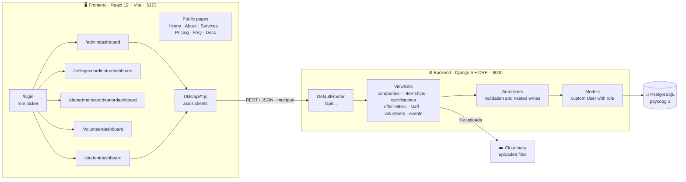
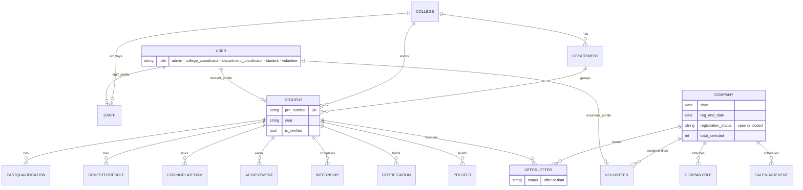

<div align="center">

<picture>
  <source media="(prefers-color-scheme: dark)" srcset="Frontend/src/assets/DarkLogo.png">
  
</picture>

# TrackTNP

<a href="https://github.com/aniruddha9674/TrackTNP">
  
</a>

<br/>


<p>
  <a href="#-overview">Overview</a> •
  <a href="#-features">Features</a> •
  <a href="#-architecture">Architecture</a> •
  <a href="#️-data-model">Data model</a> •
  <a href="#-api-reference">API</a> •
  <a href="#-getting-started">Setup</a> •
  <a href="#-project-status">Status</a>
</p>

</div>

---

## 📖 Overview

**TrackTNP** is a web platform for a college Training & Placement (T&P) cell. It tracks recruitment **drives**, student **eligibility and registrations**, **offer letters** and **placement results**, and gives each kind of user a dashboard of their own.

> [!NOTE]
> The repo has two apps: `Backend/` (Django REST API on PostgreSQL) and `Frontend/` (React + Vite SPA). The placement statistics in the `Company` model are broken down by four named colleges (PCCOE, PCCOER, NMIET and NCER) and their branches.

| | |
|---|---|
| 🏢 **Drives** | Company drives with eligibility rules, registration windows, venue, package details and result counts |
| 🎓 **Students** | Profiles, internships, certifications, projects, offer letters and a built-in resume builder |
| 🧑‍💼 **Staff** | College and department coordinators, plus student volunteers who help run drives |
| 📅 **Coordination** | Shared calendar, notifications and placement-results dashboards |

---

## ✨ Features

<table>
<tr>
<td width="50%" valign="top">

### 🏢 Drive management
- Create and edit company drives (type, profile, openings, date, venue)
- **Eligibility rules**: batch years, branches, colleges, SSC / HSC / CGPA cut-offs, backlog criteria
- Registration window (`reg_end_date`, open or closed) and resume requirement
- Attach multiple files per drive (stored on **Cloudinary**)
- Dashboard stats: total drives, open drives, completed drives, total placements

</td>
<td width="50%" valign="top">

### 📊 Placement results
- Attendance and selection counts per drive
- Breakdown per college and per branch (computer, AI/ML, IT, ENTC, mechanical, civil)
- Results views for admins, coordinators and department coordinators
- Offer letters with a status; a joining-letter file is required once an offer is finalised

</td>
</tr>
<tr>
<td width="50%" valign="top">

### 🎓 Student workspace
- Detailed student profile with qualifications, semester SGPA, coding-platform links and achievements
- Internships, certifications and projects with file uploads
- Company registration, calendar and notifications
- **Resume builder**: 9 templates (ATS, modern, creative) with LaTeX export

</td>
<td width="50%" valign="top">

### 👥 People and access
- Five roles: Admin, College Coordinator, Department Coordinator, Volunteer, Student
- Admin creates staff and volunteer accounts (optional password; otherwise an unusable password so it can be set later)
- Light and dark themes across the app
- Pages for About, Services, Pricing, FAQ, Docs and Privacy

</td>
</tr>
</table>

### 👥 Dashboards by role

| Role | Dashboard route | Main views |
|---|---|---|
| 🛡️ Admin | `/admindashboard` | Overview, staff, volunteers, companies and drives, results, students, calendar, notifications |
| 🏛️ College Coordinator | `/collegecoordinatordashboard` | Overview, students, results, companies, calendar, notifications |
| 🧑‍🏫 Department Coordinator | `/departmentcoordinatordashboard` | Overview, students, offer letters, results, companies, calendar |
| 🙋 Volunteer | `/volunteerdashboard` | Overview, companies, history, calendar, notifications |
| 🎓 Student | `/studentdashboard` | Overview, company registration, offer letters, internships, certifications, projects, resume builder, feedback, profile |

---

## 🏗️ Architecture



---

## 🗄️ Data model



Models: `User`, `College`, `Department`, `Staff`, `Student`, `PastQualification`, `SemesterResult`, `CodingPlatform`, `Achievement`, `Company`, `CompanyFile`, `Internship`, `Certification`, `Project`, `Notification`, `OfferLetter`, `CalendarEvent`, `Volunteer`.

---

## 🔌 API reference

Everything is served under `/api/` by a DRF `DefaultRouter`, plus the Django admin at `/admin/`. Each resource below supports the standard `GET` (list, detail), `POST`, `PUT` / `PATCH` and `DELETE`.

| Resource | Endpoint | Notes |
|---|---|---|
| 🏢 Companies (drives) | `/api/companies/` | List uses a lighter serializer than detail |
| | `/api/companies/dashboard-stats/` | `GET` totals: drives, open, completed, placements |
| | `/api/companies/{id}/upload-file/` | `POST` multipart, field `files` (multiple) |
| | `/api/companies/{id}/delete-file/{file_id}/` | `DELETE` one attached file |
| 🧑‍💼 Staff | `/api/staff/` | Creates the linked `User` with the coordinator role |
| 🙋 Volunteers | `/api/volunteers/` | Creates the linked `User`; password optional |
| 💼 Internships | `/api/internships/` | Scoped to the current student |
| 📜 Certifications | `/api/certifications/` | Scoped to the current student |
| 📄 Offer letters | `/api/offer-letters/` | Scoped to the current student |
| 📅 Calendar events | `/api/events/` | Colour, event type, target colleges / departments / years |

> [!NOTE]
> The API is open for development: `permission_classes` are `AllowAny` and the student-scoped endpoints read from a fixed student record. See [Project status](#-project-status).

---

## 📁 Project structure

```text
TrackTNP/
├── Backend/
│   ├── requirements.txt
│   └── backend/                       # Django project root (manage.py lives here)
│       ├── manage.py
│       ├── backend/                   # settings.py · urls.py · wsgi.py · asgi.py
│       └── api/
│           ├── models.py              # all models (users, students, drives, offers, events)
│           ├── urls.py                # DRF router
│           ├── migrations/            # 0001 … 0007
│           ├── serializers/           # company · student · staff · calendar
│           └── views/                 # company · student · staff · calendar viewsets
└── Frontend/
    ├── package.json
    ├── vite.config.js
    └── src/
        ├── App.jsx                    # route table
        ├── Pages/                     # public pages + one shell per dashboard
        ├── components/
        │   ├── AdminDashboard/        # Company · Staff · Student · Result · Volunteer · Calendar
        │   ├── CollegeCoordinator/
        │   ├── DeptcoordinatorDash/
        │   ├── VolunteerDashboard/
        │   └── StudentDashboard/      # incl. ResumeBuilder/ (9 templates + LaTeX exporter)
        └── Utils/                     # api/ (axios clients) · context/ + Hooks/ (theme)
```

---

## 🚀 Getting started

### Prerequisites


### 1 · Clone

```bash
git clone https://github.com/aniruddha9674/TrackTNP.git
cd TrackTNP
```

### 2 · Database

```sql
CREATE USER placement_user WITH PASSWORD 'choose_a_password';
CREATE DATABASE tracktnp OWNER placement_user;
```

### 3 · Backend

```bash
cd Backend
python -m venv venv
# Windows: venv\Scripts\activate      macOS/Linux: source venv/bin/activate
pip install -r requirements.txt
cd backend
```

Create `Backend/backend/.env` (next to `manage.py`):

```env
DB_NAME=tracktnp
DB_USER=placement_user
DB_PASSWORD=choose_a_password
DB_HOST=localhost
DB_PORT=5432

CLOUDINARY_CLOUD_NAME=your_cloud_name
CLOUDINARY_API_KEY=your_api_key
CLOUDINARY_API_SECRET=your_api_secret
```

```bash
python manage.py migrate
python manage.py createsuperuser      # then sign in at /admin/
python manage.py runserver            # http://127.0.0.1:8000
```

> [!IMPORTANT]
> Uploads (profile photos, company files, offer letters) go straight to Cloudinary, so the three `CLOUDINARY_*` values are required for any upload to work.
>
> The student-scoped endpoints currently read the student with primary key **1**. Create a `Student` for that id (through the Django admin) before opening the student dashboard.

### 4 · Frontend

```bash
cd Frontend
npm install
npm run dev                           # http://localhost:5173
```

> [!NOTE]
> The API base URL is hard-coded to `http://127.0.0.1:8000/api` in `src/Utils/api/*.js`, so run the backend on port 8000. The `VITE_API_URL` variable mentioned in `Frontend/README.md` is not read anywhere yet.

---

## 📊 Project status

| Area | Status |
|---|:---:|
| Data model and 7 migrations (users, students, drives, offers, events) | ✅ Working |
| Company drives API with dashboard stats and Cloudinary file upload | ✅ Working |
| Staff and volunteer CRUD (creates linked user accounts) | ✅ Working |
| Internships, certifications, offer letters, calendar events API | ✅ Working (student-scoped routes use a fixed student id) |
| Resume builder (9 templates, LaTeX export) | ✅ Working (frontend) |
| Authentication | 🚧 SimpleJWT is configured, but there are no login or token endpoints. The login page picks a dashboard from the role you select and does not call the API |
| Access control | 🚧 API permissions are `AllowAny`, and dashboard routes are not guarded |
| Projects API | 🚧 `ProjectViewSet` exists but is not registered in `api/urls.py`, so `/api/projects/` returns 404 |
| Students, notifications, company-files endpoints | 🚧 Models exist, no endpoints yet (the frontend calls `/api/company-files/`) |
| Linux / CI builds | 🚧 Three imports differ in letter case from the files on disk: `StudentDashboard/overview`, `Utils/api/companyApi` and `assets/demo.mp4`. They work on Windows and macOS only |
| Automated tests | ❌ None yet |

### 🗺️ Roadmap

- [x] Role-aware dashboards and route table
- [x] Drive, eligibility and results data model
- [x] Cloudinary file storage
- [ ] Login and token endpoints, then protect the API and dashboard routes
- [ ] Replace the fixed student id with `request.user`
- [ ] Register `projects` and add students, notifications and company-files endpoints
- [ ] Read the API URL from `VITE_API_URL`
- [ ] Fix the three case-sensitive import paths
- [ ] Add a `.gitignore` for `Backend/` (`venv/`, `.env`, `__pycache__/`, `db.sqlite3`) and an `.env.example`
- [ ] Unit and API tests

---

## 🤝 Contributing

1. Fork the repo and create a branch: `git checkout -b feature/your-feature`
2. Commit your changes: `git commit -m "feat: describe your change"`
3. Push and open a pull request

<div align="center">

<br/>

**⭐ If this project is useful, consider giving it a star.**

</div>
